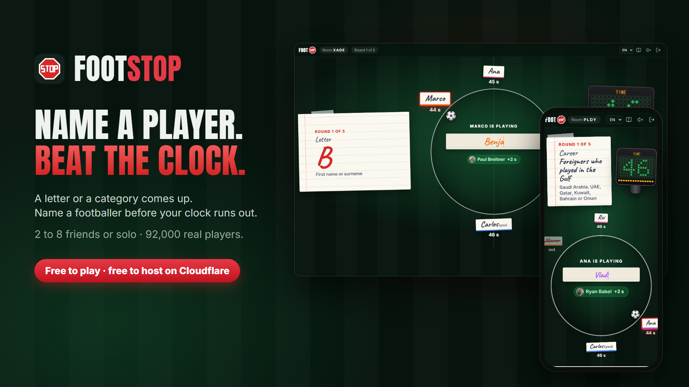
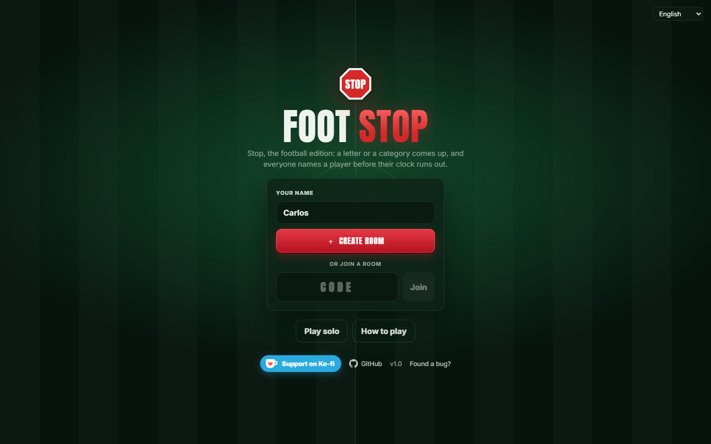
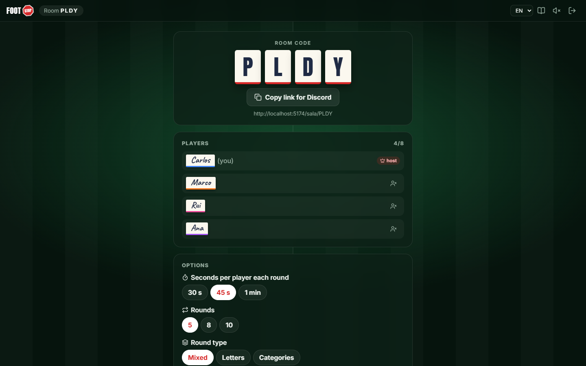
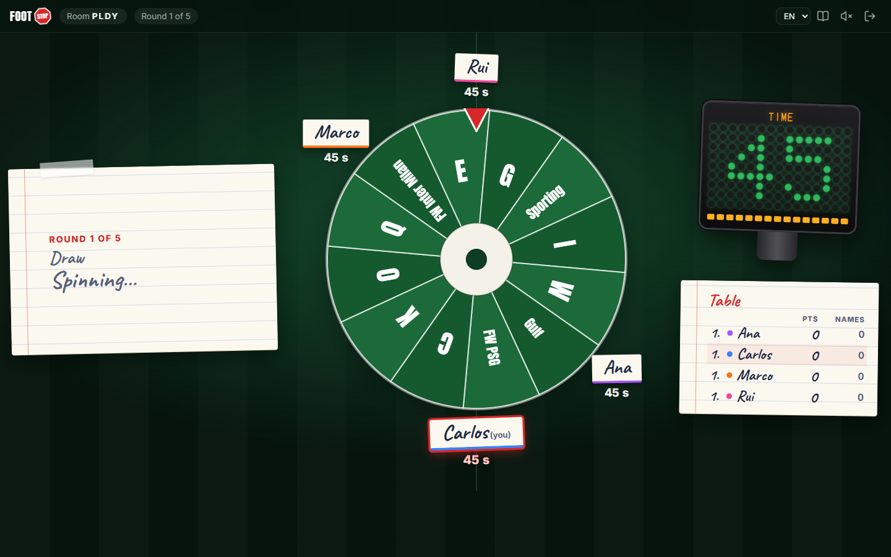
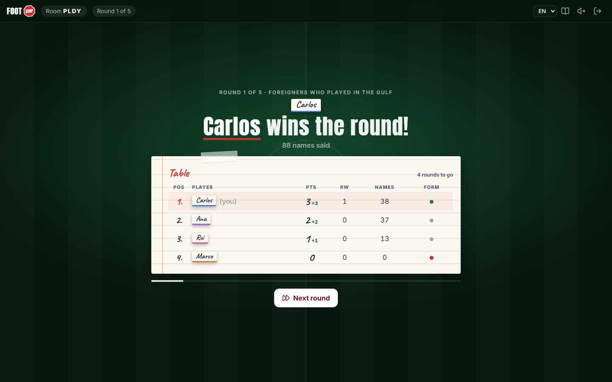
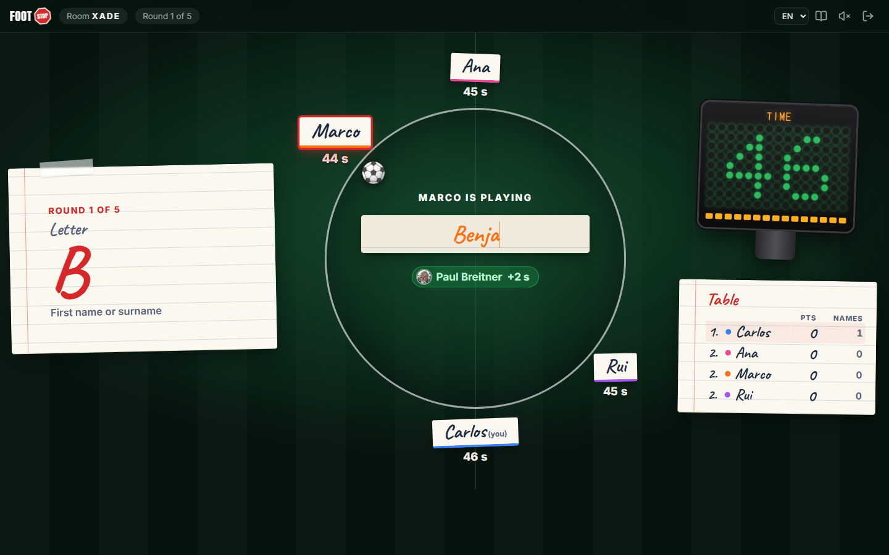
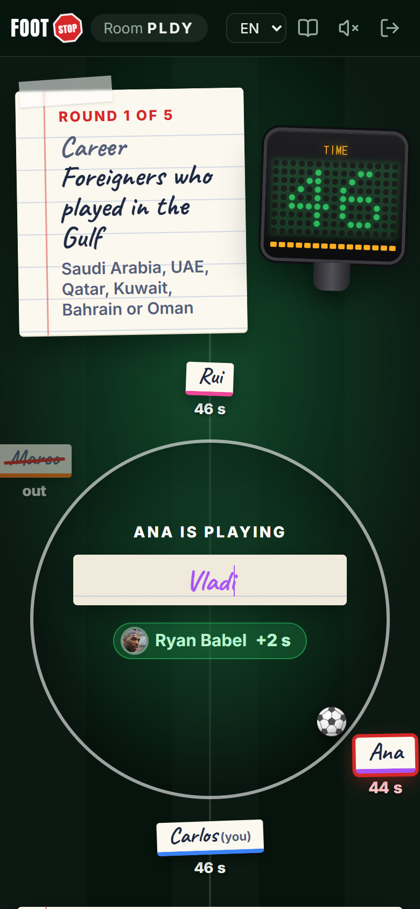
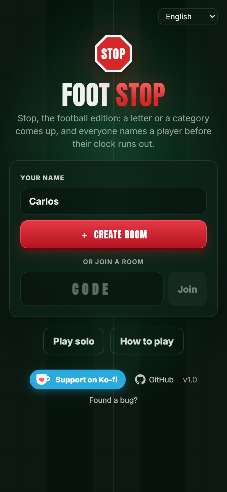

<div align="center">



**Stop, the football edition: a letter or a category comes up, and everyone names a footballer before their clock runs out.**<br>
A fast party game for 2 to 8 friends (or alone), with a chess clock, 92,000 real players and no time to think. Free to host on Cloudflare.

<a href="https://footstop.fc-intel.workers.dev"></a>  <a href="LICENSE.md"></a>    <a href="https://ko-fi.com/bacoinz"></a>

[**▶ Play now**](https://footstop.fc-intel.workers.dev) · [How to play](#how-to-play) · [Run your own](#run-your-own) · [Report a bug](https://github.com/bacoinz/footstop/issues/new/choose) · [🇵🇹 Português](README.pt-PT.md)

</div>

> [!TIP]
> **Try it right now:** open **[footstop.fc-intel.workers.dev](https://footstop.fc-intel.workers.dev)**, create a room and share the link with your friends. No account, no install. Or press **Play solo** and see how many names you get.

## Why Footstop

"Stop" (or *Scattergories*) is played with paper and pen: a letter comes up and everyone races to fill in a name. Footstop is that game for football fans, played out loud and against the clock, like a quiz show buzzer round.

A letter (**M**) or a category (**Played for Benfica**, **Born in the 80s**, **Fewer than 10 caps**) is drawn on the centre circle. Taking turns, each player types a footballer who fits and the ball is passed straight to the next one, whose clock is already running. A right name gives you two seconds back. Run out of time and you're out. The last one standing wins the round.

## Features

**The game**

- **A chess clock per player:** 30 s, 45 s or 1 minute per round. It only runs on your turn, a right name adds +2 s and passing costs 5 s.
- **215 letters and categories:** clubs, clubs in an era (*Played for Manchester United between 2000 and 2010*), nationalities, leagues, positions, decades, caps, and careers (managers, foreigners in MLS or the Gulf).
- **Letters, categories or both:** the host picks the round type, the length (5, 8 or 10 rounds) and the time.
- **League-style points:** with N players the round winner gets N−1 points and the last one 0, with a table, rounds won, names and form after every round.
- **A trump card** for whoever finishes last: it fills in a name for you in the next round.
- **Sudden death** when the top is tied at the end: 15 seconds and no bonus.
- **Solo mode:** start with 1, 3 or 5 rounds and lose one for every wrong name, pass or time-out. Beat your own record.
- **Stats and fun facts** at the end: fastest finger, longest streak, saved by the bell, the star of the game.

**The names**

- **92,000 real footballers** from Wikidata, checked in milliseconds: full name, surname or nickname (*Messi*, *Pepe*, *CR7*).
- **One wrong letter is forgiven** (*Mesi* counts as Messi), but a name is never completed for you (*Manu* is not Manuel Neuer).
- **Vague names ask which one you meant:** *Silva* at Benfica shows up to three options, and only one fits the round.
- **Unknown names are checked on Wikidata live**, with your clock stopped meanwhile.

**Everything else**

- **The centre circle is the board:** a draw wheel, then the answer box, with players' name tags around it and a ball passed from one to the next.
- **Live typing:** everyone sees what the player on the clock is typing.
- **Sounds:** the pass of the ball on a right name, the whistle at kick-off, a goal at the end of the round.
- **English and Portuguese**, switchable in the menu.
- **Works on phones**, and rooms survive a dropped connection.

## Screenshots

<table>
  <tr>
    <td width="50%"></td>
    <td width="50%"></td>
  </tr>
  <tr>
    <td></td>
    <td></td>
  </tr>
  <tr>
    <td></td>
    <td> </td>
  </tr>
</table>

## How to play

1. **Create a room** at [footstop.fc-intel.workers.dev](https://footstop.fc-intel.workers.dev) and share the link (Discord works great). The host picks the seconds per player, the number of rounds and the round type.
2. **The centre circle spins** and draws a letter or a category. Six seconds later the first player's clock starts.
3. **On your turn, type a footballer and press Enter.** Right: +2 s and the ball goes to the next player. Wrong: try again, your clock keeps running. Stuck: pass with **Esc** (−5 s).
4. **Names:** first name and surname, just the surname, or the nickname. In letter rounds the first name or the surname must start with the letter, and a first name alone (*Lionel*) doesn't count. The same player can't be said twice in a round.
5. **Out of time, you're out.** The last one standing wins the round, and everyone scores by their place.
6. **After the last round**, the most points wins. A tie at the top goes to sudden death.

The full rules are in the in-game **How to play** menu.

## Run your own

You need Node 22+ and, to put it online, a free Cloudflare account. It takes about 10 minutes, and there is nothing to configure: no database to create, no secrets.

```bash
git clone https://github.com/bacoinz/footstop && cd footstop
npm install
npm run dev
```

The game runs at `http://localhost:5174`. Open it in two windows to play against yourself (add `?p=2` to the second address so it counts as another player), or run a whole game with bots:

```bash
node scripts/playtest.ts http://localhost:5174 3
```

**Putting it online:**

1. Log in to Cloudflare from the terminal: `npx wrangler login`.
2. Optional: change the Worker name in `wrangler.jsonc` (`"name"`). It becomes your address: `https://<name>.<your-subdomain>.workers.dev`.
3. Deploy: `npm run deploy`.

That's it: share the address with your friends. The first deploy creates the Durable Object that runs the rooms.

**Refreshing the players:** the database (`public/data/players.bin`) is built from Wikidata by `npm run build:db`. It uses a cache in `scripts/.cache`. Delete that folder to download everything again (it takes a while: Wikidata is queried in batches). Clubs, countries and categories are in [`shared/categories.ts`](shared/categories.ts).

## What it costs

Nothing, on Cloudflare's free plans. Each room is one Durable Object, and the game talks over a WebSocket that hibernates while nobody plays.

| Service | Free plan | What it means here |
|---|---|---|
| Workers | 100,000 requests/day | Pages, assets and connections for many games a day |
| Durable Objects (SQLite) | Free tier included | One per room; empty rooms delete themselves after 6 hours |

## How it works

| Part | What it uses |
|---|---|
| Server | **Cloudflare Workers** + one **Durable Object** per room (WebSockets with hibernation, alarms for the clocks) |
| Game engine | Plain TypeScript in `shared/engine.ts`: pure functions shared by the server and the tests |
| Name checking | `shared/match.ts`: name keys, one-letter typos, vague names, all in memory |
| Player data | **Wikidata**, packed into a 2.8 MB file served as a static asset |
| Interface | **React 19 + Vite**, with Motion for the animations |

- **The server is authoritative:** the browser only sends what was typed, and the room checks every name and runs every clock.
- **Translations:** the interface strings are in [`src/lib/i18n.tsx`](src/lib/i18n.tsx), and the server sends its messages in both languages so each player reads their own.
- **Tests:** about 65, with Vitest, on the engine, the name rules and samples of the real database.

```
worker/          Worker and Durable Object (the room), live Wikidata checks
shared/          Game engine, name matching, categories, stats, database format
src/             Interface (React): home, lobby, the centre circle, tables
scripts/         Database build from Wikidata, a bot playtest
tests/           Tests (Vitest)
public/data/     The player database
```

Useful commands: `npm run dev`, `npm test`, `npm run build:db`, `npm run deploy`.

## Found a bug?

This is version **1.0**, and there will be bugs: a name that should count and doesn't, one that counts and shouldn't, a category with odd answers. If you find one, please **[open an issue](https://github.com/bacoinz/footstop/issues/new/choose)** saying what you typed, in which round, and what happened. A screenshot helps. Ideas for new categories are welcome too.

## Support

Footstop is free and has no ads. If you enjoyed it, you can buy me a coffee:

<a href="https://ko-fi.com/bacoinz"></a>

## Credits

- Player data: [Wikidata](https://www.wikidata.org) (CC0). Photos: [Wikimedia Commons](https://commons.wikimedia.org), loaded from Commons with their own licences.
- Footstop is a fan-made game, not affiliated with any club, league or player.

## License

[PolyForm Noncommercial 1.0.0](LICENSE.md). Free of charge, you can use it, change it and host it for yourself and your friends, a school or a non-profit. Selling it, or selling access to it as a service, is not allowed. For anything commercial, ask the author.
