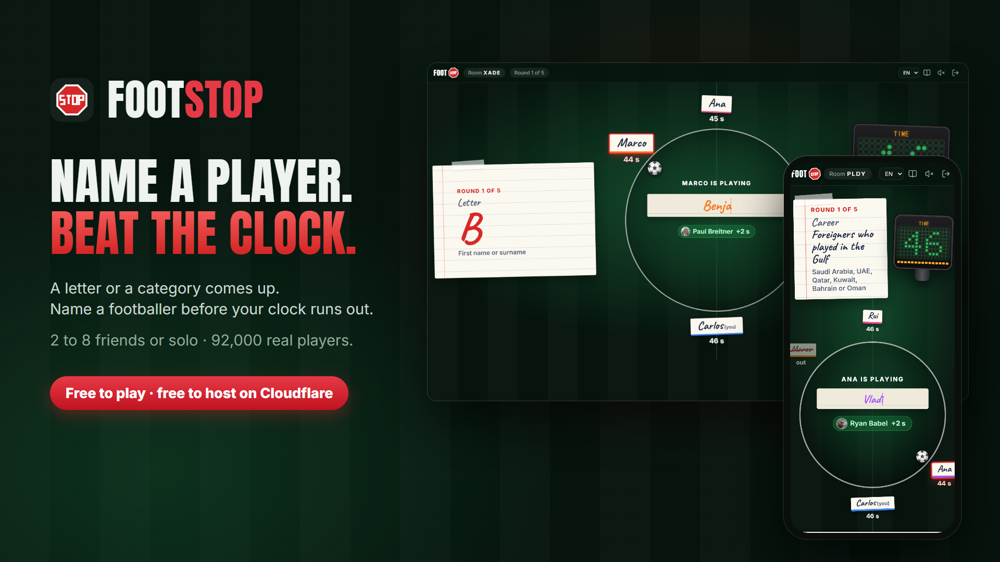

<div align="center">



**O Stop do futebol: sai uma letra ou uma categoria e cada um diz um futebolista antes que o relógio acabe.**<br>
Um jogo rápido para 2 a 8 amigos (ou a solo), com relógio de xadrez, 92 mil jogadores reais e sem tempo para pensar. Grátis para alojar na Cloudflare.

<a href="https://footstop.fc-intel.workers.dev"></a>  <a href="LICENSE.md"></a>  <a href="https://ko-fi.com/bacoinz"></a>

[**▶ Jogar agora**](https://footstop.fc-intel.workers.dev) · [Como jogar](#como-jogar) · [Alojar o teu](#alojar-o-teu) · [Reportar um bug](https://github.com/bacoinz/footstop/issues/new/choose) · [🇬🇧 English](README.md)

</div>

> [!TIP]
> **Experimenta já:** abre **[footstop.fc-intel.workers.dev](https://footstop.fc-intel.workers.dev)**, cria uma sala e partilha o link com os amigos. Sem conta e sem instalar nada. Ou carrega em **Jogar sozinho** e vê quantos nomes consegues.

## O jogo

Sai uma letra (**M**) ou uma categoria (**Jogou no Benfica**, **Nascidos nos anos 80**, **Menos de 10 internacionalizações**) no círculo central. À vez, cada jogador escreve um futebolista que sirva e a bola passa logo para o próximo, com o relógio dele já a contar. Um nome certo dá +2 s. Quem fica sem tempo sai da ronda e o último a resistir ganha.

- **Relógio de xadrez:** 30 s, 45 s ou 1 minuto por ronda. Só desconta na tua vez; passar custa 5 s.
- **215 letras e categorias:** clubes, clubes numa época, nacionalidades, campeonatos, posições, décadas, internacionalizações e carreiras.
- **Pontos à liga:** com N jogadores, o vencedor da ronda ganha N−1 pontos e o último 0, com tabela classificativa depois de cada ronda.
- **Trunfo** para quem fica em último, **morte súbita** em caso de empate e **modo a solo** com recorde.
- **92 mil futebolistas** da Wikidata: nome e apelido, só o apelido ou a alcunha (*Messi*, *Pepe*, *CR7*). Uma letra errada é perdoada (*Mesi*), mas nenhum nome é completado (*Manu* não é o Manuel Neuer).
- **Nomes vagos** (*Silva*, *Tiago*) mostram até 3 opções, das quais só uma serve.
- **Inglês e português**, à escolha no menu.

## Como jogar

1. **Cria uma sala** em [footstop.fc-intel.workers.dev](https://footstop.fc-intel.workers.dev) e partilha o link. O anfitrião escolhe os segundos, o número de rondas e o tipo de rondas.
2. **O círculo central roda** e sorteia a ronda. Seis segundos depois começa o relógio do primeiro jogador.
3. **Na tua vez, escreve um futebolista e carrega em Enter.** Certo: +2 s e a vez passa. Errado: tenta outra vez. Sem ideias: passa com **Esc** (−5 s).
4. **Quem fica sem tempo sai da ronda.** No fim das rondas ganha quem tiver mais pontos.

As regras completas estão no menu **Como jogar** do jogo.

## Alojar o teu

Precisas do Node 22+ e, para o pôr online, de uma conta gratuita da Cloudflare. Não há base de dados para criar nem segredos para configurar.

```bash
git clone https://github.com/bacoinz/footstop && cd footstop
npm install
npm run dev
```

O jogo abre em `http://localhost:5174`. Para jogar contra ti próprio, abre uma segunda janela com `?p=2` no fim do endereço.

**Para o pôr online:**

1. Entra na Cloudflare pelo terminal: `npx wrangler login`.
2. Opcional: muda o nome do Worker em `wrangler.jsonc` (`"name"`). Passa a ser o teu endereço: `https://<nome>.<o-teu-subdomínio>.workers.dev`.
3. Publica: `npm run deploy`.

**Atualizar os jogadores:** `npm run build:db` gera `public/data/players.bin` a partir da Wikidata, com uma cache em `scripts/.cache` (apaga-a para descarregar tudo de novo). Os clubes, países e categorias estão em [`shared/categories.ts`](shared/categories.ts).

Custa 0 €: cada sala é um Durable Object, dentro do plano gratuito da Cloudflare.

## Encontraste um bug?

Esta é a versão **1.0** e vai haver bugs: um nome que devia valer e não vale, um que vale e não devia, uma categoria com respostas estranhas. Se encontrares um, **[abre um issue](https://github.com/bacoinz/footstop/issues/new/choose)** com o que escreveste, em que ronda e o que aconteceu. Uma imagem ajuda. Ideias de categorias também são bem-vindas.

## Apoiar

O Footstop é gratuito e não tem anúncios. Se gostaste, podes oferecer-me um café:

<a href="https://ko-fi.com/bacoinz"></a>

## Licença

[PolyForm Noncommercial 1.0.0](LICENSE.md). Grátis para usar, alterar e alojar para ti e para os teus amigos, uma escola ou uma associação sem fins lucrativos. Não é permitido vendê-lo nem vender o acesso como serviço. Para usos comerciais, fala com o autor.

Dados dos jogadores: [Wikidata](https://www.wikidata.org) (CC0). Fotografias: [Wikimedia Commons](https://commons.wikimedia.org). O Footstop é um jogo feito por fãs, sem ligação a clubes, ligas ou jogadores.
